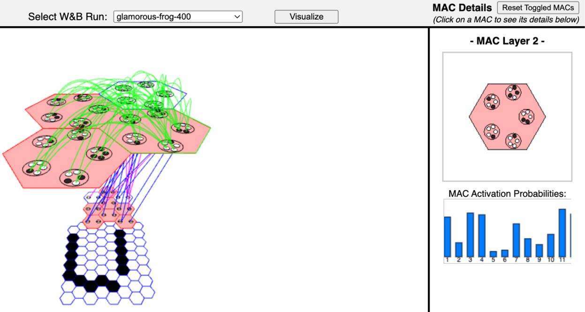
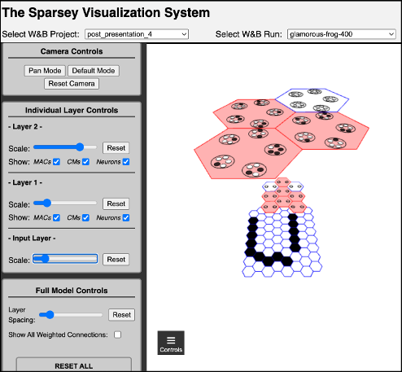

# Sparsey Visualization System (SVS)

The **Sparsey Visualization System (SVS)** is an interactive, extensible tool for exploring Sparsey's cognitive memory models. It offers a powerful visualization interface for inspecting sparse distributed representations (SDRs) and hierarchical memory structures. This project integrates backend logic written in Python with a web-based frontend to support inspection, debugging, and model interpretation.

SVS is designed with modularity and best practices in mind, extending the principles of the *Zen of Python* through the use of proven architectural patterns across both backend and frontend.

---

## Application Preview

The screenshots below show the completed SVS web interface using Sparsey model data generated by the Sparsey Testing System (STS) and accessed through Weights & Biases.

### Interactive Model and MAC Details



*The interactive model view with MAC details, connection visualization, and activation probabilities.*

### Visualization Controls and Layer Navigation



*Navigation, display, and model-layer controls alongside a rendered Sparsey instance.*

---

## 🚀 Getting Started

### 1. Clone the Repository

```bash
git clone https://github.com/dhruvshr/sparseypy_visualizer.git
cd sparseypy_visualizer
```

### 2. Set Up a Virtual Environment

```bash
python3 -m venv .venv
# Activate:
# macOS/Linux:
source .venv/bin/activate
# Windows:
.\venv\Scripts\Activate.ps1
```

### 3. Install Dependencies

```bash
pip install -r requirements.txt
```

---

## 🧪 Development Tools

We recommend the following during development:

- **Jupyter Notebooks**: For prototyping visualizations, metrics exploration, and experimenting with different data pipelines.
- **Flask**: For serving the backend and handling run selection, parsing, and visualization requests.
- **Three.js**: For rendering 3D components of Sparsey Models.

---

## 🔧 System Requirements

### Hardware
- **CPU**: 4+ cores with hyperthreading
- **RAM**: Minimum 8 GB (16 GB recommended)
- **Storage**: 5 GB+ of free SSD space
- **GPU**: Optional; integrated graphics sufficient

### OS Support
- macOS ✅ (preferred)
- Linux ✅ (recommended for ML workflows)
- Windows ✅ (via native Python or WSL)

### Python Version
- Python 3.11 or higher required

To check your version:
```bash
python3 --version  # macOS/Linux
python --version   # Windows
```

---

## 📦 Key Dependencies

- **Visualization**: Three.js (frontend)
- **Backend**: Flask, wandb, numpy, pandas
- **Environment Management**: virtualenv, pipenv (optional)

Refer to `requirements.txt` for the full list of dependencies.

---

## 🛠️ Running the Application

### 1. Start Flask Server

```bash
python main.py
```

You’ll see output similar to:

```
Serving Flask app 'src.web.app'
Running on http://127.0.0.1:5000
```

### 2. Open in Browser

Visit:

```
http://127.0.0.1:5000/
```

You should see the SVS GUI. If the GUI does not load, ensure your server is active and no port conflicts exist.

---

## 👥 Contributing

### Branching & Version Control

```bash
git checkout -b <your-feature-branch>
# After changes
git add .
git commit -m "Your commit message"
git push origin <your-feature-branch>
```

Submit a Pull Request (PR) via GitHub for code review and integration.

### Testing

Test your features thoroughly. Use or expand unit tests where applicable. You may use:

```bash
pytest
```

---

## ⚙️ Role-Specific Launch Modes

### Developers

```bash
# macOS/Linux
export FLASK_ENV=development
export FLASK_APP=app.py
flask run

# Windows PowerShell
$env:FLASK_ENV="development"
flask run
```

### Deployers (Production)

Set required environment variables (e.g., `WANDB_API_KEY`, `FLASK_PORT`) prior to deployment.

### End Users

Download ZIP from GitHub, extract, and follow steps from **System Installation** (Sections 2–5 above). No Git or server knowledge is required to run the application locally.

---

## 📁 Directory Structure

```
sparseypy_visualizer/
│
├── main.py                 # Entry point for Flask backend
├── requirements.txt        # Python dependencies
├── src/
│   ├── core/               # Model and data logic
│   └── web/                # Flask views and routes
└── notebooks/              # Jupyter dev and test notebooks
```

---

## 🤝 License

This project is under development and privately maintained. Licensing details may be made available.
